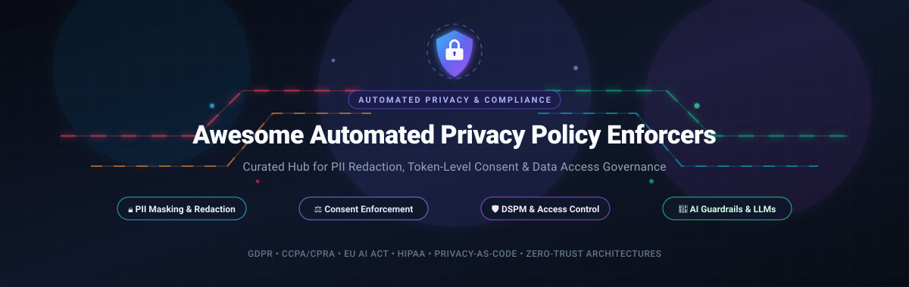

# 🛡️ Awesome Automated Privacy Policy Enforcers

<div align="center">

<a href="https://github.com/ishandutta2007/Awesome-Awesome-Awesome"></a><a href="https://discord.gg/jc4xtF58Ve"></a> <a href="https://github.com/ishandutta2007/Awesome-Automated-Privacy-Policy-Enforcers/stargazers"></a> <a href="https://github.com/ishandutta2007/Awesome-Automated-Privacy-Policy-Enforcers/network/members"></a> <a href="https://github.com/ishandutta2007/Awesome-Automated-Privacy-Policy-Enforcers/issues"></a> <a href="https://github.com/ishandutta2007/Awesome-Automated-Privacy-Policy-Enforcers/pulls"></a> <a href="https://github.com/ishandutta2007/Awesome-Automated-Privacy-Policy-Enforcers/blob/main/LICENSE"></a> <a href="https://github.com/ishandutta2007"></a>

<br/><br/>

[](https://github.com/ishandutta2007/Awesome-Automated-Privacy-Policy-Enforcers)

<br/>

### 🌟 Curated Directory of Enterprise SaaS Platforms & Open-Source Privacy Engineering Infrastructure

*Specialized in Deterministic PII Redaction, Token-Level Consent Enforcement, Privacy-as-Code & Data Access Governance*

**Last updated: March 2026**

</div>

---

## 📖 Overview & SEO Summary

**Automated Privacy Policy Enforcers** are specialized security and compliance software components that sit directly between raw enterprise data streams and external systems, consumers, or third-party Large Language Models (LLMs). These solutions automate regulatory compliance under **GDPR**, **CCPA/CPRA**, **EU AI Act**, **HIPAA**, and **DPDP** by:

- 🔒 **Scrubbing & Redacting PII/PHI**: Detecting and stripping sensitive entities (names, SSNs, credit cards, emails, API keys) before data leaves protected perimeters.
- ⚖️ **Token-Level Consent Enforcement**: Dynamically validating user opt-ins, purpose limitations, and retention policies at runtime.
- 🛡️ **Data Access Governance & DSPM**: Enforcing attribute-based access control (ABAC), differential privacy, and dynamic masking over data warehouses and lakes.
- 🤖 **AI Guardrails & Zero-Trust Proxies**: Sanitizing prompt inputs and deterministic placeholder reconstruction on LLM responses to prevent model regurgitation or unauthorized leakage.

---

## 📑 Table of Contents

- [📊 Sector Overview & Market Dynamics](#-sector-overview--market-dynamics)
- [🏢 Enterprise SaaS & Hosted Platforms](#-enterprise-saas--hosted-platforms)
- [💻 Open-Source GitHub Projects](#-open-source-github-projects)
- [🏗️ Architectural Reference Patterns](#️-architectural-reference-patterns)
- [🤝 How to Contribute](#-how-to-contribute)
- [💖 Support & Sponsoring](#-support--sponsoring)
- [⭐ Star History](#-star-history)
- [⚖️ Disclaimer](#️-disclaimer)

---

## 📊 Sector Overview & Market Dynamics

The global **privacy management software and automated data governance market** is estimated at **$4.1B to $5.5B in 2026** and is projected to expand rapidly past **$30B by 2030**, reflecting a remarkable compound annual growth rate (**CAGR of ~35%–40%**). This accelerating growth is propelled by compounding cross-border privacy regulations, hefty non-compliance penalties, and the explosive enterprise adoption of generative AI agents requiring strict zero-egress data perimeters.

From a structural perspective, the sector is **moderately fragmented**: while legacy market leader OneTrust captures significant enterprise footprint through an expansive end-to-end suite, this is **not a winner-take-all market**. The landscape accommodates high-velocity innovation, with specialized platforms securing strong market positions across distinct operational segments—such as **Transcend** (developer-first Privacy-as-Code), **Securiti.ai** (unified AI data command centers), **BigID** and **Immuta** (deep DSPM and cloud lakehouse access governance), and **Osano** and **Ketch** (agile consent management)—complemented by a thriving ecosystem of modular open-source privacy engines.

---

## 🏢 Enterprise SaaS & Hosted Platforms

The following enterprise platforms deliver turnkey hosted privacy infrastructure, continuous discovery, and multi-cloud policy enforcement.

> *Ranked in descending order by estimated company valuation / annual revenue scale.*

| 🏢 Platform | 💰 Company Size (Valuation / Revenue) | 🏷️ Starting Pricing | 🎁 Free Tier / Trial Limits | 🔍 Key Capabilities & Focus |
| :--- | :--- | :--- | :--- | :--- |
| **[OneTrust](https://www.onetrust.com/)** | **Valuation: $4.5B** *(Series D; peak $5.3B)*<br/>**ARR: ~$550M** | **Starts at ~$10,000/yr** *(~$833/mo base entry module)* | **14-day free trial** *(Available for web consent modules: up to 1 domain scan, cookie compliance banner setup, and basic reporting; no permanent free tier)* | Comprehensive enterprise trust intelligence suite covering universal consent management, data mapping, automated DSAR fulfillment, vendor risk, and AI governance. |
| **[Securiti.ai](https://securiti.ai/)** | **Valuation: $1.725B** *(Acquired by Veeam)*<br/>**ARR: ~$50M+** | **Starts at ~$18,000/yr** *(~$1,500/mo baseline Data Command Center package)* | **14-day sales-assisted PoC trial** *(Includes connection to 1 cloud data source e.g. AWS S3 or Snowflake, automated DSPM classification scan, and risk dashboard)* | Unified Data Command Center combining Data Security Posture Management (DSPM), automated privacy operations, contextual policy enforcement, and LLM firewalling. |
| **[BigID](https://bigid.com/)** | **Valuation: $1.25B** *(Series E unicorn)*<br/>**ARR: ~$100M** | **Starts at ~$25,000/yr** *(Express tier baseline deployment)* | **Free Data Risk Assessment** *(1-time scan of 1 cloud data repository to detect exposed PII/sensitive data; or 14-day assisted enterprise PoC)* | ML-augmented data intelligence platform delivering deep automated discovery, sensitive data classification, and regulatory compliance across multicloud repositories. |
| **[Immuta](https://www.immuta.com/)** | **Valuation: $1.0B** *(Series E unicorn)*<br/>**ARR: ~$50M+** | **Starts at ~$25,000/yr** *(Equivalent to £1,000–£8,000/user/yr baseline brackets)* | **14-day cloud trial** *(Available via AWS/Snowflake Marketplace: governance testing for up to 5 users and 1 active cloud warehouse connection)* | Universal data access governance platform providing dynamic attribute-based access control (ABAC), column/row-level masking, and real-time audit logs across cloud data platforms. |
| **[Transcend](https://transcend.io/)** | **Valuation: ~$450M** *($90M raised; Series B)*<br/>**ARR: ~$20M+** | **Starts at ~$10,000/yr** *(~$833/mo starter tier)* | **14-day developer sandbox trial** *(Available upon demo approval: includes Privacy Request API testing with up to 10 mock DSAR runs and 2 data silo connections)* | Developer-first "Privacy-as-Code" infrastructure automating full-lifecycle DSAR fulfillment across backend databases, telemetry consent orchestration, and AI prompt privacy. |
| **[DataGrail](https://www.datagrail.io/)** | **Valuation: ~$250M** *($84M raised; Series C)*<br/>**ARR: ~$20M+** | **Starts at ~$30,000/yr** *(Mid-market entry platform agreement)* | **14-day pilot PoC** *(Via sales engineering: includes integration testing with up to 3 SaaS connectors e.g. Salesforce/Zendesk and up to 25 test DSARs)* | Continuous data mapping with 1,000+ pre-built SaaS integrations, automated DSAR request handling, and third-party vendor risk assessment without manual surveys. |
| **[Privacera](https://privacera.com/)** | **Valuation: ~$200M** *($67.3M raised; Series B)*<br/>**ARR: ~$25M+** | **Starts at ~$12,000/yr** *(~$1,000/mo for PrivaceraCloud baseline)* | **30-day free trial on PrivaceraCloud** *(Connect 1 cloud data source, test Apache Ranger-backed access policies and dynamic masking for up to 5 users)* | Hybrid-cloud data security posture and fine-grained access governance with dynamic masking across Databricks, Snowflake, AWS, and GCP data estates. |
| **[MineOS](https://www.mineos.ai/)** | **Valuation: ~$120M** *($42M raised; Series B)*<br/>**ARR: ~$10M+** | **Starts at ~$8,000/yr** *(~$667/mo base automation package)* | **Free forever plan available** *(Manages up to 2 active data sources, up to 10 incoming DSRs/year, and manual request workflow; plus 14-day full trials on request)* | Rapid-onboarding PrivacyOps platform automating continuous data discovery, customer data subject requests, consent mapping, and AI inventory governance. |
| **[Osano](https://www.osano.com/)** | **Valuation: ~$100M** *($44M raised; Series B)*<br/>**ARR: ~$15M** | **Free forever tier ($0/mo)**;<br/>Paid Plus starts at **$199/mo** *($2,388/yr)* | **Free forever plan** *(1 user, 1 website domain, up to 5,000 monthly unique visitors; includes cookie consent banner and script blocking); 30-day free trial on paid plans* | Consent management platform (CMP) featuring cookie banners, script blocking, vendor privacy ratings, "no-fines" compliance guarantee, and DSAR workflows. |
| **[Ketch](https://www.ketch.com/)** | **Valuation: ~$80M** *($23M raised; Series A)*<br/>**ARR: ~$8M** | **Free forever tier ($0/mo)**;<br/>Paid Starter starts at **$150/mo** *($1,800/yr)* | **Free forever plan** *(Up to 5,000 unique monthly visitors, 2 active application integrations, full consent experience designer and regulation templates)* | Dynamic programmatic consent and preference management, automated data rights fulfillment, and cross-channel policy orchestration via smart tags. |

---

## 💻 Open-Source GitHub Projects

Open-source implementations enable complete data residency, deterministic PII masking, and vendor-independent privacy engineering.

> *Ranked in descending order by GitHub Stars_Count.*

### 1. **[Presidio](https://github.com/data-privacy-stack/presidio)** (Data Privacy Stack / Microsoft) [](https://github.com/data-privacy-stack/presidio/stargazers)
Context-aware, customizable PII detection, redaction, and de-identification SDK and REST API for text, images, and structured data. Utilizes pre-trained NER models (spaCy/transformers) and customizable pattern recognizers with reversible masking capabilities.

### 2. **[PySyft](https://github.com/OpenMined/PySyft)** (OpenMined) [](https://github.com/OpenMined/PySyft/stargazers)
Flagship open-source framework for privacy-preserving decentralized AI, enabling secure computation across distributed data owners using differential privacy, federated learning, and encrypted computation without exposing underlying data.

### 3. **[Guardrails AI](https://github.com/guardrails-ai/guardrails)** (Guardrails AI) [](https://github.com/guardrails-ai/guardrails/stargazers)
Runtime guardrails framework for LLMs enforcing privacy policies, PII filtering/masking, toxicity checks, structured outputs, and compliance rules directly on prompts and model responses.

### 4. **[Amundsen](https://github.com/amundsen-io/amundsen)** (Amundsen IO) [](https://github.com/amundsen-io/amundsen/stargazers)
Data discovery and metadata engine that indexes enterprise data assets, automates data privacy tagging (PII classification), tracks lineage, and enforces compliance policies across enterprise data stacks.

### 5. **[Purple Llama](https://github.com/meta-llama/PurpleLlama)** (Meta) [](https://github.com/meta-llama/PurpleLlama/stargazers)
Open-source trust, safety, and privacy evaluation tools, including Llama Guard and cybersecurity benchmarks, to prevent data leaks and enforce privacy boundaries in generative AI applications.

### 6. **[Google Differential Privacy](https://github.com/google/differential-privacy)** (Google) [](https://github.com/google/differential-privacy/stargazers)
Production-grade differential privacy libraries (C++, Go, Java, Python) implementing mathematically verified privacy guarantees for dataset aggregation, statistical queries, and machine learning pipelines.

### 7. **[Probo](https://github.com/getprobo/probo)** (Probo Inc.) [](https://github.com/getprobo/probo/stargazers)
Self-hostable, modern open-source GRC platform featuring 270+ Model Context Protocol (MCP) tools for LLM agent integration, complete with DPIA/TIA workflows, automated data privacy rights handling, and policy-based access control.

### 8. **[Apache Ranger](https://github.com/apache/ranger)** (Apache Software Foundation) [](https://github.com/apache/ranger/stargazers)
Centralized enterprise security and governance framework providing fine-grained access control, dynamic column masking, row-level filtering, and audit logging across distributed Hadoop and cloud data environments.

### 9. **[Diffprivlib](https://github.com/IBM/differential-privacy-library)** (IBM Research) [](https://github.com/IBM/differential-privacy-library/stargazers)
General-purpose Python library for differential privacy in machine learning and data analytics, providing privacy-preserving Scikit-learn estimators, mechanisms, and evaluation metrics.

### 10. **[ARX De-Identifier](https://github.com/arx-deidentifier/arx)** (ARX Project) [](https://github.com/arx-deidentifier/arx/stargazers)
Comprehensive anonymization suite supporting state-of-the-art privacy models including k-anonymity, l-diversity, t-closeness, and differential privacy for sensitive structured datasets and clinical research data.

### 11. **[Gretel Synthetics](https://github.com/gretelai/gretel-synthetics)** (Gretel AI) [](https://github.com/gretelai/gretel-synthetics/stargazers)
Differential-privacy-backed synthetic data generation library that creates statistically valid, PII-free synthetic tabular data and text to safely replace production personal data in dev/testing pipelines.

### 12. **[Privado](https://github.com/Privado-Inc/privado)** (Privado) [](https://github.com/Privado-Inc/privado/stargazers)
Developer-focused privacy static code analysis (SAST) tool that inspects codebases to track personal data flows, detect privacy vulnerabilities, generate data maps, and enforce privacy policies in CI/CD before code merges.

### 13. **[Fides](https://github.com/ethyca/fides)** (Ethyca) [](https://github.com/ethyca/fides/stargazers)
Open-source "Privacy-as-Code" platform (Apache-2.0) that enables engineering teams to define privacy declarations in YAML, orchestrate live DSRs (access/erasure), and automate runtime consent across relational and NoSQL databases.

### 14. **[OpenDP](https://github.com/opendp/opendp)** (Harvard & Microsoft) [](https://github.com/opendp/opendp/stargazers)
Community-driven library providing mathematically certified differential privacy building blocks in Rust and Python for privacy-preserving statistical research and data science.

### 15. **[Pryv.io](https://github.com/pryv/open-pryv.io)** (Pryv) [](https://github.com/pryv/open-pryv.io/stargazers)
Turnkey open-source personal data management and consent backend engineered for regulatory compliance (GDPR/Swiss DPA), featuring auditable consent tracking and encrypted data streams.

### 16. **[Eunomia](https://github.com/whataboutyou-ai/eunomia)** (WhatAboutYou AI) [](https://github.com/whataboutyou-ai/eunomia/stargazers)
Token-level data governance framework for LLM-based applications and AI agents, offering modular instruments (such as `PiiInstrument`) to intercept, redact, or replace sensitive tokens prior to model inference.

### 17. **[OpenOptOut](https://github.com/rlnunez/OpenOptOut)** (RL Nunez) [](https://github.com/rlnunez/OpenOptOut/stargazers)
Self-hosted, distributed platform automating personal data removal requests to data brokers using zero-knowledge identity vaults and multi-tenant consortium routing.

### 18. **[ODRE Framework](https://github.com/ODRE-Framework/odre-framework)** (ODRE Project) [](https://github.com/ODRE-Framework/odre-framework/stargazers)
Open Digital Rights Enforcement framework leveraging the W3C ODRL specification to define and enforce decentralized privacy and data-sharing policies across open data spaces.

### 19. **[Membrane](https://github.com/rishabh-oberoi/membrane-ai)** (Rishabh Oberoi) [](https://github.com/rishabh-oberoi/membrane-ai/stargazers)
Zero-trust local privacy SDK that intercepts LLM prompts, deterministically masks PII locally, and reconstructs original entities from model responses, even under heavy semantic paraphrasing.

### 20. **[Prompt Redaction Studio](https://github.com/Bhairav-Pardiwala/PromptRedactionStudio)** (Bhairav Pardiwala) [](https://github.com/Bhairav-Pardiwala/PromptRedactionStudio/stargazers)
Self-hosted, zero-egress PII redaction application utilizing Microsoft Presidio with in-memory-only reversible mapping tokens to ensure no sensitive text touches persistent storage or external APIs.

### 21. **[pii-masker-ai](https://github.com/lui01212/pii-masker-ai)** (Lui01212) [](https://github.com/lui01212/pii-masker-ai/stargazers)
Ultra-fast, zero-dependency reversible PII masking library and CLI scanner for CI/CD pre-commit pipelines, featuring Luhn credit-card validation and sequential reversible tokens.

### 22. **[promptcloak](https://github.com/ezequiel0822-netizen/promptcloak)** (Ezequiel Netizen) [](https://github.com/ezequiel0822-netizen/promptcloak/stargazers)
Lightweight, zero-dependency secret and token sanitizer with Shannon entropy scanning to catch undocumented API keys and private data before prompt dispatch.

### 23. **[ODGS MCP Server](https://github.com/MetricProvenance/odgs-mcp-server)** (MetricProvenance) [](https://github.com/MetricProvenance/odgs-mcp-server/stargazers)
AI agent boundary governance server connecting to the ODGS Sovereign Validation Engine to evaluate data operations and output cryptographically signed compliance certificates (S-Certs).

---

## 🏗️ Architectural Reference Patterns

Combining complementary open-source and enterprise tools creates robust, layered defense-in-depth architectures:

```
[ Inbound User Request / Prompt ]
                │
                ▼
┌──────────────────────────────────────────┐
│ 1. Client Boundary & Prompt Sanitization │ ──► (e.g. Presidio / Membrane / Promptcloak)
│    • Deterministic PII / API Key Masking │
│    • In-memory ephemeral placeholder map │
└──────────────────────────────────────────┘
                │
                ▼
┌──────────────────────────────────────────┐
│ 2. Policy & Consent Evaluation Engine    │ ──► (e.g. Fides / Ketch / Eunomia)
│    • Token-level user opt-in verification │
│    • Purpose & retention rule validation │
└──────────────────────────────────────────┘
                │
                ▼
┌──────────────────────────────────────────┐
│ 3. Secure Execution / LLM Pipeline       │ ──► (e.g. Guardrails AI / Purple Llama)
│    • Sandboxed model inference           │
│    • Dynamic output compliance filtering │
└──────────────────────────────────────────┘
                │
                ▼
┌──────────────────────────────────────────┐
│ 4. Downstream Storage & Lakehouse Access │ ──► (e.g. Immuta / Apache Ranger / Amundsen)
│    • Attribute-Based Access Control      │
│    • Cryptographic audit logging & DSRs  │
└──────────────────────────────────────────┘
```

---

## 🤝 How to Contribute

We welcome community contributions! To add a new platform or open-source tool:

1. 🍴 **Fork the repository**.
2. 📝 **Add your entry** under the appropriate section:
   - For **SaaS platforms**: Include platform name, company size (valuation/revenue), starting tier price, and specific free tier / trial duration and limits.
   - For **Open-source projects**: Include GitHub repository link, Stars_Badge (`style=social&color=white`), and a concise description of its privacy capabilities. Maintain star-count sorting order!
3. 🚀 **Submit a Pull Request** with a clear explanation of the tool's relevance to automated privacy policy enforcement.

---

## 💖 Support & Sponsoring

Thank you for exploring this curated repository! If this guide helps you or your team build safer, privacy-compliant systems, please consider showing your support:

- ⭐ **Star** this repository to increase visibility and help fellow engineers discover it.
- 🍴 **Fork** and contribute new tools or corrections to keep the ecosystem up to date.
- 📢 **Share** with your privacy engineering, compliance, or security colleagues.
- ☕ **Sponsor the Project**: If you'd like to support ongoing curation and maintenance, consider buying me a coffee via the [GitHub Sponsors Dashboard](https://github.com/sponsors/ishandutta2007).

---

## ⭐ Star History

[](https://star-history.dera.page/#ishandutta2007/Awesome-Automated-Privacy-Policy-Enforcers&type=date&legend=top-left)

---

## ⚖️ Disclaimer

- 📌 This repository is a **community-curated index** for informational and educational purposes—not an explicit legal or compliance endorsement.
- 🛡️ Handling sensitive personal information (PII/PHI) requires adherence to statutory data protection regulations (GDPR, CCPA/CPRA, HIPAA, DPDP) and continuous audit trail preservation.
- ⚠️ **Probabilistic Detection**: Regex and NLP models do not guarantee 100% detection recall. Multi-engine defense-in-depth and human-in-the-loop review for high-risk pipelines remain standard best practices.
- 🔐 **Correlation Risks**: Ephemeral, in-memory token mappings with strict TTLs are strongly recommended to prevent placeholder re-identification risks.
